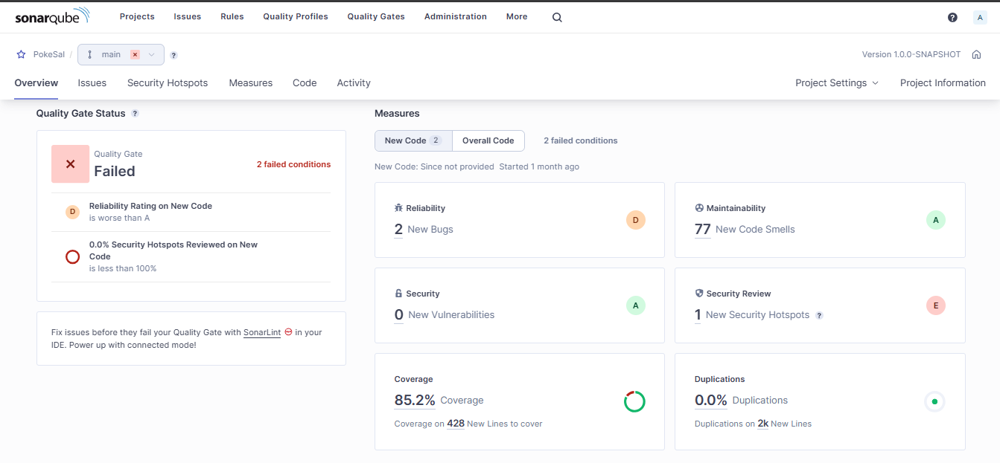
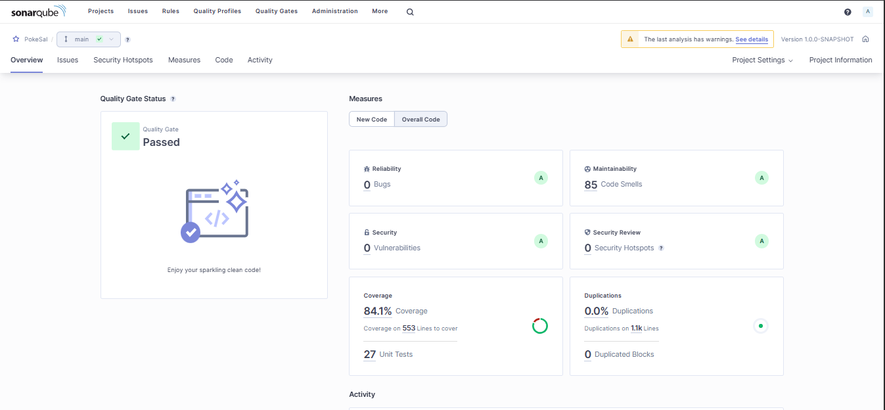
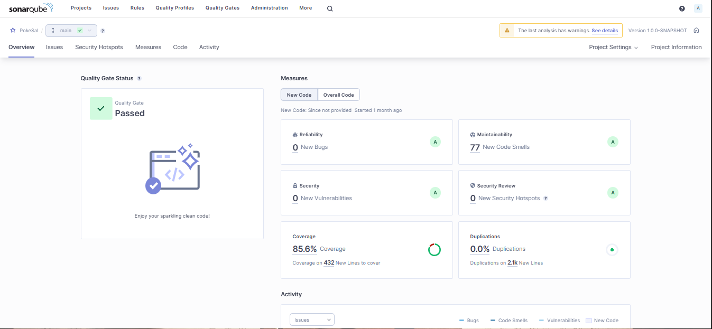
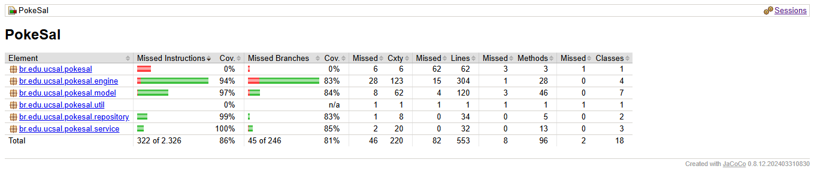
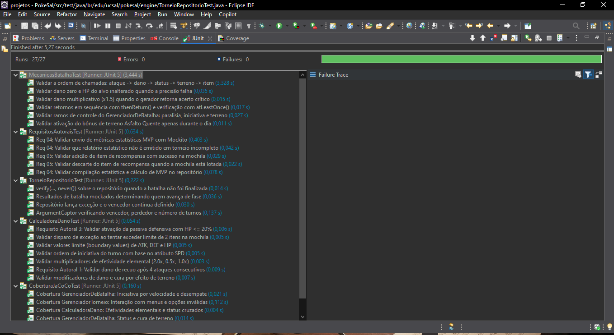
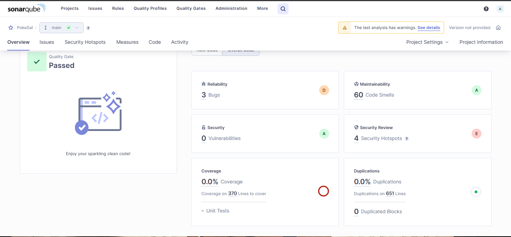
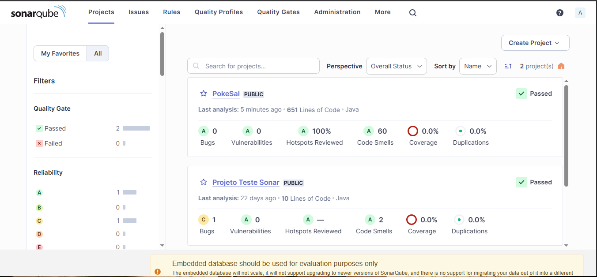
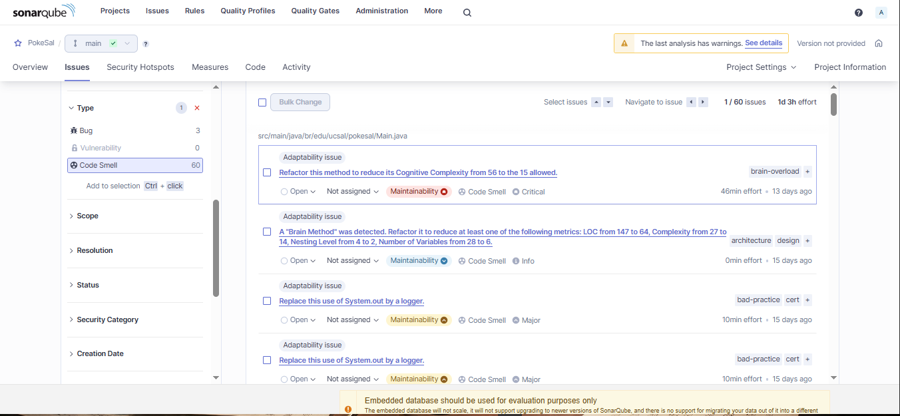
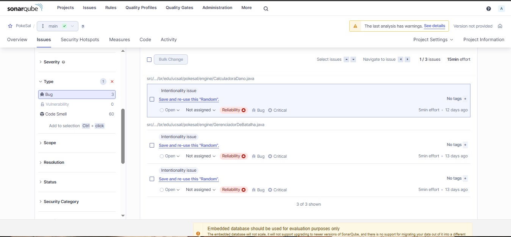
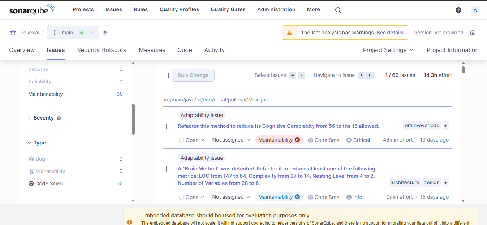

# Relatório Comparativo SonarQube e Integração Contínua (Fase 02 vs. Fase 03)

Universidade Católica do Salvador – UCSal  
Curso: Análise e Desenvolvimento de Sistemas  
Disciplina: Testes e Qualidade de Software  
Professor: Pedro Arthur de Melo Nascimento  
Projeto: PokéSal – Simulador de Batalha (Fase 03)  
Requisito: 4.5 – SonarQube Comparativo e Integração Contínua  

Integrantes:
- Arivaldo Teixeira Moraes Neto
- Cauã de Oliveira Lopes
- Pedro Luiz de Barros Pereira
- Ryan Abade Oliveira

---

## 1. Visão Geral e Configuração da Análise

Este relatório consolida a evolução da qualidade estática e da cobertura de código do projeto PokeSal entre a Fase 02 (baseline) e a Fase 03 (entrega final). A análise foi realizada por meio do SonarQube Community Edition integrado ao ciclo de vida do Apache Maven (`mvn clean verify sonar:sonar`), com extração automatizada de métricas de cobertura via JaCoCo (`target/site/jacoco/jacoco.xml`) e validação de regras de estilo com o Checkstyle (`google_checks.xml`).

Na Fase 03, o projeto obteve aprovação formal no Quality Gate (status Passed) com 27 testes unitários aprovados, alcançando 84,1% de cobertura no Overall Code e 85,6% no New Code (além de 86% de instruções e 81% de branches no relatório detalhado do JaCoCo), superando o piso regulamentar de 70% estipulado para a disciplina, com 0 Bugs, 0 Vulnerabilidades e 0,0% de código duplicado.

---

## 2. Comparativo Consolidado (Fase 02 vs. Fase 03 – Overall Code)

A tabela abaixo compara o estado geral da base de código (Overall Code) entre a Fase 02 e a versão final aprovada na Fase 03:

| Métrica | Fase 02 (Baseline) | Fase 03 (Final) | Variação | Avaliação |
| --- | --- | --- | --- | --- |
| Quality Gate | Passed | Passed | Neutra | Aprovado em ambas as fases |
| Linhas de Código (LOC) | 651 | 1.144 (~1,1k) | +493 (+75,7%) | Expansão de funcionalidades e suítes de testes |
| Bugs | 0 (Rating A) | 0 (Rating A) | 0 | Confiabilidade máxima (Rating A) |
| Vulnerabilidades | 0 (Rating A) | 0 (Rating A) | 0 | Segurança máxima (Rating A) |
| Security Hotspots Revisados | 100% (Rating A) | 100% (Rating A) | 0% | 1 hotspot auditado e classificado como seguro |
| Code Smells | 60 (Rating A) | 85 (Rating A) | +25 (+41,7%) | Manutenibilidade máxima mantida (Rating A) |
| Cobertura (JaCoCo) | 0,0% | 84,1% | +84,1% | Cobertura expressiva, superando a meta de 70% |
| Duplicações | 0,0% | 0,0% | 0,0% | Ausência de código redundante |

---

## 3. Ciclo de Correção na Fase 03 (Execução Intermediária vs. Execução Final)

Durante a integração contínua na Fase 03, a primeira análise gerou reprovação inicial no Quality Gate por conta de apontamentos no código novo. Um ciclo de correção foi aplicado no código-fonte e no painel do SonarQube para sanar essas pendências:

| Métrica | Execução Intermediária (Antes) | Execução Final (Depois) | Ação de Correção |
| --- | --- | --- | --- |
| Quality Gate | Failed | Passed | Correção dos bloqueadores de New Code |
| New Bugs | 2 (Rating D) | 0 (Rating A) | Ajustes em verificação defensiva e asserção de teste |
| New Hotspots Revisados | 0,0% (Rating E) | 100% (Rating A) | Revisão técnica de segurança no painel do SonarQube |
| New Code Smells | 77 (Rating A) | 77 (Rating A) | Débito técnico estável (< 5% do teto A) |
| Cobertura em Linhas Novas | 85,2% (428 LOC) | 85,6% (432 LOC) | Cobertura mantida com folga sobre a meta de 70% |
| Cobertura Geral | 83,8% | 84,1% | Elevação após inclusão do novo teste de métricas |

### Detalhamento das correções realizadas:

- GerenciadorTorneio.java (Possível NullPointerException): o SonarQube apontava que o atributo vencedorBatalha poderia ser nulo no encerramento da partida. Foi adicionada uma verificação defensiva com retorno imediato de fallback caso a batalha não possua vencedor definido (`if (vencedorBatalha == null) return new ResultadoPartida(null, null);`), além de tratamento de nulidade para o nome do perdedor.
- CoberturaJaCoCoTest.java (Comparação de tipo primitivo com nulo): a asserção `assertNotNull(geradorReal.testarChance(0.5))` comparava o retorno de um tipo primitivo boolean com null. A validação foi substituída por asserções booleanas determinísticas (`assertTrue(geradorReal.testarChance(1.0))` e `assertFalse(geradorReal.testarChance(0.0))`), eliminando a inconformidade no teste.
- Main.java (Uso de gerador pseudoaleatório – regra java:S2245): o SonarQube gerou um Security Hotspot pelo uso de `new Random()`. A equipe revisou o apontamento diretamente na interface do SonarQube e o classificou como Safe (seguro), já que a aleatoriedade é usada apenas para mecânicas de jogo no terminal (iniciativa e dano), sem qualquer finalidade criptográfica ou de segurança.

---

## 4. Justificativa Técnica do Aumento de Code Smells

A única métrica que apresentou aumento numérico em relação à Fase 02 foi a contagem total de Code Smells, passando de 60 para 85 no Overall Code (sendo 77 classificados em New Code). Esse acréscimo se justifica tecnicamente pelos seguintes motivos:

1. Expansão da base de código: o projeto cresceu de 651 para 1.144 linhas de código (~75,7% de aumento). Esse crescimento reflete a implementação dos Requisitos Autorais 04 e 05, o desacoplamento das regras de negócio através de interfaces e a adição de suítes de testes unitários com Mockito. O aumento de apontamentos foi proporcional ao volume de código adicionado.
2. Manutenção da nota máxima de manutenibilidade: o SonarQube manteve a classificação no Rating A. A taxa de débito técnico calculada foi de 2,7%, índice bem inferior ao limite máximo de 5,0% tolerado para a classificação A.
3. Incidência da regra java:S106: a grande maioria dos Code Smells decorre da recomendação de substituir `System.out` por um framework de log. Como o PokeSal é um jogo de console interativo, a saída no terminal representa a interface com o usuário exigida pelo projeto, não justificando o uso de bibliotecas externas como Logback ou SLF4J. Os demais apontamentos envolvem decisões de fluxo dos turnos de combate, cobertos por testes unitários exaustivos.

---

## 5. Evidências Visuais da Análise no SonarQube e JaCoCo

As imagens abaixo registram os resultados obtidos nas análises locais:

### Painel Geral da Fase 03 – Antes das Correções (Quality Gate Failed)
Evidência da reprovação inicial com 2 bugs em New Code e hotspot pendente de revisão:

### Painel Geral da Fase 03 – Final Aprovado (Overall Code e New Code)
Evidência da aprovação final com Quality Gate verde, 0 bugs, 0 vulnerabilidades, hotspots revisados, 84,1% de cobertura geral e 85,6% em código novo:

### Cobertura Detalhada do JaCoCo e Execução JUnit (27/27 Testes)
Relatório final de cobertura por pacote (86% de instruções e 81% de branches) e aprovação integral da suíte JUnit 5:

### Evidências da Fase 02
Registros históricos do baseline da Fase 02 no SonarQube:

